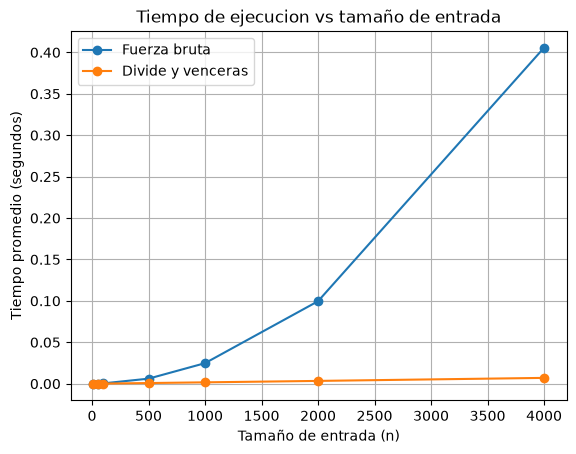

# Laboratorio evaluativo 02 — Dividir y vencer

**Nombre:** Juliana Arenas Arias

## Reproducción del laboratorio

1. Activar el entorno virtual desde la raíz del repositorio.

2. Ejecutar las pruebas:

```powershell
python pruebas.py
```

3. Ejecutar las mediciones y generar la gráfica:

```powershell
python medicion.py
```

---

# Parte 1 — Implementación y verificación

Código utilizado:

- [subarreglo.py](subarreglo.py)
- [pruebas.py](pruebas.py)

Para verificar las dos soluciones utilicé un archivo de pruebas con `assert`, comparando principalmente la suma máxima encontrada por fuerza bruta y por divide y vencerás

Primero probé la serie del enunciado `[-3, 5, -2, 8, -6, 3, 9, -4]`, donde ambas funciones devolvieron una suma máxima de `17`. También probé una lista de un solo elemento, una lista con todos los valores negativos, una con todos los valores positivos y un caso donde el mejor tramo cruza el punto medio

Además, generé 20 listas aleatorias y verifiqué que en todas las pruebas los dos algoritmos encontraran la misma suma máxima. Para los empates no comparé los índices, porque pueden existir varios tramos diferentes con la misma suma

---

# Parte 2 — Medición y gráfica

Código utilizado:

- [medicion.py](medicion.py)

Para comparar los dos algoritmos utilicé los tamaños `10`, `50`, `100`, `500`, `1000`, `2000` y `4000`. Los datos se generaron con una semilla fija y con valores enteros entre `-100` y `100`, usando la misma lista para los dos algoritmos en cada tamaño

La generación de los datos se hizo antes de iniciar el cronómetro, para medir solamente el tiempo que tardaba cada algoritmo. Cada medición se repitió tres veces y se tomó el promedio, ya que los tiempos pueden variar un poco entre ejecuciones

También verifiqué dentro del experimento que fuerza bruta y divide y vencerás encontraran la misma suma máxima para cada tamaño probado



---

# Parte 3 — Análisis

## 1. Recurrencia

En el algoritmo de divide y vencerás el problema se parte en dos mitades y se resuelve cada una por separado, por eso aparece `2T(n/2)`. También hay que revisar el tramo que cruza el punto medio. Ese caso recorre los elementos hacia la izquierda y hacia la derecha, por lo que cuesta `Θ(n)`.

La recurrencia es:

$$
T(n) = 2T(n/2) + \Theta(n)
$$

Con el método maestro, `a = 2`, `b = 2` y `f(n) = Θ(n)`. Como `n^(log₂2) = n` y `f(n)` tiene el mismo orden, se aplica el caso 2 y el resultado es `Θ(n log n)`.

En fuerza bruta, el ciclo exterior se ejecuta `n` veces. El ciclo interior no siempre hace `n` vueltas: primero hace `n`, luego `n - 1`, después `n - 2` y así hasta llegar a 1. Por eso, operaciones como acumular la suma y compararla se ejecutan en total:

$$
n + (n-1) + (n-2) + ... + 1
$$

Esta suma equivale a `n(n+1)/2`, por lo que al tomar el término que más crece la complejidad queda en `Θ(n²)`. Como la suma se va acumulando dentro del ciclo, no se vuelve a recorrer cada subarreglo desde cero.

## 2. Lo medido contra lo esperado

En la gráfica se ve que los dos algoritmos tardan más cuando aumenta `n`, pero fuerza bruta crece mucho más rápido.

Por ejemplo, al pasar de `n = 1000` a `n = 2000`, fuerza bruta pasó de `0,031902` a `0,111940` segundos, o sea unas `3,51` veces. Divide y vencerás pasó de `0,001613` a `0,003788` segundos, unas `2,35` veces.

Esto se acerca a lo esperado. En `Θ(n²)`, duplicar `n` debería multiplicar el tiempo aproximadamente por 4. En `Θ(n log n)`, para estos tamaños el aumento esperado es cercano a 2,2 veces. Los valores no son exactos porque el tiempo también depende del sistema, pero la tendencia sí coincide con la teoría.

## 3. Tamaños pequeños

En mis mediciones divide y vencerás no fue más rápido desde el principio. Con `n = 10` fuerza bruta tardó menos y con `n = 50` los dos estuvieron prácticamente iguales. Desde `n = 100` divide y vencerás ya fue más rápido.

Esto pasa porque con entradas pequeñas las llamadas recursivas y la división del problema tienen un costo que todavía pesa bastante. Cuando `n` aumenta, empieza a notarse la ventaja de `Θ(n log n)` frente a `Θ(n²)`.

## 4. ¿Cuándo conviene dividir?

Divide y vencerás no siempre mejora una solución. Por ejemplo, para hallar el máximo de un arreglo se puede dividir la lista en dos, buscar el máximo de cada mitad y comparar los dos resultados.

La recurrencia sería:

$$
T(n) = 2T(n/2) + \Theta(1)
$$

Por el método maestro da `Θ(n)`. Pero recorrer el arreglo una sola vez también cuesta `Θ(n)`. Entonces dividir no mejora la complejidad y además agrega llamadas recursivas.

Por eso conviene dividir cuando esa estrategia realmente reduce la complejidad frente a una solución directa, no solo porque el problema se pueda partir.

## 5. Concepto para la gerente

De acuerdo con las pruebas, recomendaría divide y vencerás. Con `n = 4000`, fuerza bruta tardó `0,405654 segundos` y divide y vencerás `0,007018 segundos`.

Para estimar 1.000.000 de registros no hice una regla de tres lineal. En fuerza bruta escalé el tiempo según `n²`:

$$
0.405654
\left(
\frac{1\,000\,000}{4000}
\right)^2
$$

El resultado es aproximadamente `25.353 segundos`, unas `7,04 horas`.

Para divide y vencerás escalé según `n log n`, comparando el crecimiento entre los dos tamaños. El resultado estimado es aproximadamente `2,92 segundos`.

Estos valores son una estimación, no una medición real. Aun así, la diferencia muestra que para series grandes divide y vencerás es una opción mucho más adecuada.